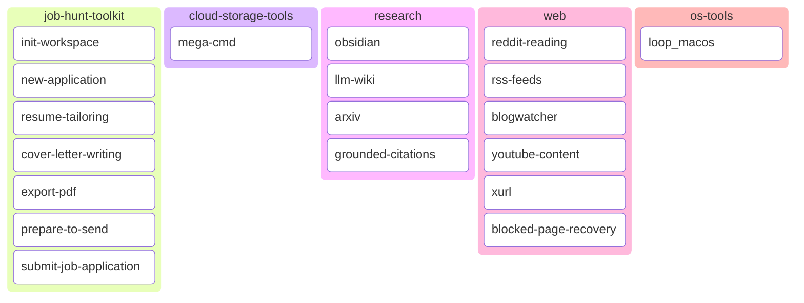
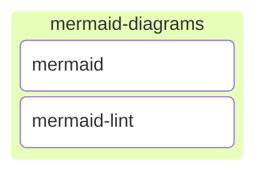
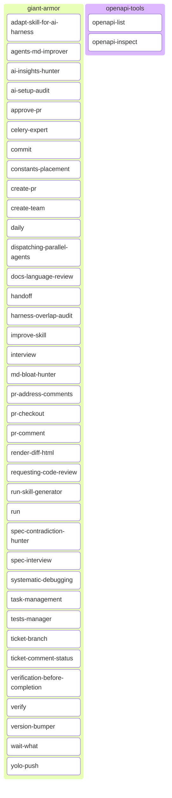
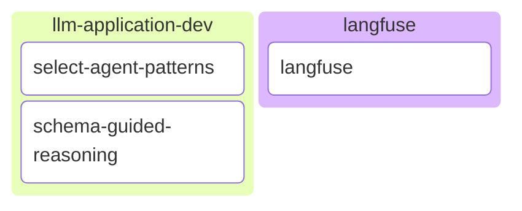

# 🗡️ Zweihander (+5 Chaos)

Simple, robust, and versatile marketplace for agent plugins,
forged for the chaos of the AI world.

It collects practical tools for Codex and Claude Code across LLM observability,
API exploration, development workflows, assistant operations, research notes,
cloud storage, local automation, runtime app verification, and job-search
workflows.

## About

I am currently working on AI harness tools and trying to stay ahead of the curve.

I am open to new opportunities in AI engineering, LLM applications, and developer
tools.

[✉️ Email me](mailto:alexkopylov123@gmail.com)

## Selected Projects

- [Zweihander](https://github.com/Alex-Kopylov/zweihander) — an agent-plugin
  marketplace for Codex and Claude Code.
- [AI-Ready Modern Python
  Template](https://github.com/Alex-Kopylov/ai-ready-modern-python-template) — a
  practical starting point for AI-ready Python projects.
- [GH Babysitter](https://github.com/Alex-Kopylov/gh-babysitter) — GitHub
  workflow automation for keeping work moving.

## Temporary files

Skills use `${ZWEIHANDER_TMP_DIR:-./.tmp/zweihander}/runs/<skill>/<run-id>/`
for internal temporary files. Set `ZWEIHANDER_TMP_DIR` to choose another root;
relative paths start from the working directory where the skill runs.
Each skill controls the contents and cleanup of its run directory.

This convention does not move existing outputs: decision logs, audit reports,
HTML diffs, screenshots, CVs, and other established results keep their paths.

## Plugin Catalog

### General User Productivity



### General AI User Productivity



### Programming



### AI Engineer



## Notes for Users

Use this README when you want to install the marketplace, install a plugin, or
choose what each plugin is for. Developer and maintenance notes live in
`AGENTS.md`.

This repository is licensed under Apache-2.0; see `LICENSE`. Third-party
provenance and license notices live in `third_party/`.

## Quick Install

### Codex

Add the marketplace:

```shell
codex plugin marketplace add Alex-Kopylov/zweihander
```

Install a plugin:

```shell
codex plugin add langfuse@zweihander
```

List available plugins:

```shell
codex plugin list
```

Update the installed marketplace:

```shell
codex plugin marketplace upgrade zweihander
```

### Claude Code

Add the marketplace from inside Claude Code:

```shell
/plugin marketplace add Alex-Kopylov/zweihander
```

Install a plugin:

```shell
/plugin install langfuse@zweihander
```

Update the installed marketplace:

```shell
/plugin marketplace update zweihander
```

For scripts or automation, use the non-interactive CLI:

```shell
claude plugin marketplace add Alex-Kopylov/zweihander
claude plugin install langfuse@zweihander
claude plugin marketplace update zweihander
```

## How to Use

1. Add this marketplace to Codex or Claude Code.
2. Pick a plugin from the catalog below.
3. Install the plugin with `plugin@zweihander`, for example
   `langfuse@zweihander`.
4. Ask the assistant naturally for the workflow you want. The installed plugin
   contributes skills, agents, or both.

## Plugins

### `langfuse`

**Use when:** you need to inspect Langfuse data, create or update evaluation
assets, compare experiment runs, or manage dashboard widgets.

#### Skills

| Skill | Description |
| --- | --- |
| `langfuse` | Unified Langfuse skill for data discovery, metrics, datasets, experiment runs, evaluators, dashboard widgets, and dashboard management. Former task-specific workflows are bundled as internal references. |

#### Agents

| Agent | Description |
| --- | --- |
| `langfuse-data-explorer` | Read-only discovery for scores, traces, models, and metrics. |
| `langfuse-dataset-expert` | Dataset creation, item management, and schema design. |
| `langfuse-eval-manager` | Evaluator CRUD, filters, and status management. |
| `langfuse-experiment-manager` | Experiment runs, analysis, comparison, and webhooks. |
| `langfuse-widget-manager` | Dashboard and widget creation, updates, and suggestions. |

### `openapi-tools`

**Use when:** you have a running API service and want the assistant to discover
available endpoints or inspect operation details.

#### Skills

| Skill | Description |
| --- | --- |
| `openapi-list` | List available OpenAPI routes. |
| `openapi-inspect` | Inspect endpoint inputs, outputs, and schema details. |

### `llm-application-dev`

<details>
<summary>
LLM application design, agent pattern selection, and schema-guided reasoning
patterns.
</summary>

**Use when:** you need to choose LLM workflow patterns, compare agent
architecture trade-offs, or design structured schemas that guide model
reasoning.

#### Skills

| Skill | Description |
| --- | --- |
| `select-agent-patterns` | Choose LLM workflow and agent design patterns by decomposing a problem into stages and comparing candidates. Based on [A Two-Dimensional Framework for AI Agent Design Patterns](https://arxiv.org/pdf/2605.13850). |
| `schema-guided-reasoning` | Design structured Pydantic schemas that guide LLM reasoning. |

#### Skill Agents

| Skill | Agent | Description |
| --- | --- | --- |
| `select-agent-patterns` | `pattern-fit-reviewer` | Independently review one candidate pattern for one workflow stage. |

</details>

### `giant-armor`

<details>
<summary>
Development, session and assistant-operations workflows in one plugin: git,
PRs, tickets, releases, Python testing, run-and-verify, session tooling, and
skill improvement.
</summary>

**Use when:** you want development, session or assistant-operations support:
commits, PRs, tickets, releases, visual diffs, spec checks, Python test-first
work, running and verifying an app, daily notes, interviews, team design,
task tracking, handoffs, AGENTS.md audits, skill improvement, harness
adaptation, overlap audits, insight capture, or Markdown bloat trimming.

**Origin note:** several methodology skills were copied from the MIT-licensed
[Superpowers](https://github.com/obra/superpowers) project by Jesse Vincent;
`handoff` comes from Matt Pocock's skills; see
`third_party/THIRD_PARTY_NOTICES.md` for provenance.

#### Skills

| Skill | Description |
| --- | --- |
| `adapt-skill-for-ai-harness` | Adapt explicitly named skills using a JSON assistant action matrix and target-specific harness references. |
| `agents-md-improver` | Audit and improve repository AGENTS.md files. |
| `ai-insights-hunter` | Extract reusable decisions, patterns, and preferences from a session. |
| `ai-setup-audit` | Audit assistant configuration files for conflicts and bloat. |
| `approve-pr` | Approve and merge PRs with current checks and policy gates. |
| `celery-expert` | Configure Celery tasks, workers, retries, schedules, performance, and security. |
| `commit` | Create single-line Conventional Commits. |
| `constants-placement` | Decide where each hardcoded value belongs (its module, a shared `constants.py`, a pydantic-settings field, or `.env` for secrets) and move it, merging duplicates and keeping `.env` out of git. |
| `create-pr` | Open pull requests from the current branch. |
| `create-team` | Design a multi-agent team and handoff plan. |
| `daily` | Generate a daily note from project activity. |
| `dispatching-parallel-agents` | Coordinate independent subagent tasks that can run concurrently. |
| `docs-language-review` | Review or rewrite Markdown documentation using plain-language and cognitive-accessibility standards. |
| `handoff` | Compact the current conversation for another agent. |
| `harness-overlap-audit` | Map skills, MCP tools, and skill agents whose scope overlaps, in a Markdown report with Venn diagrams. |
| `improve-skill` | Improve existing skills through eval feedback, baseline comparison, iteration, and trigger checks. |
| `interview` | Walk through a list of items one by one, logging every decision before anything runs. |
| `md-bloat-hunter` | Trim redundancy, verbosity, and filler in Markdown and `.md.j2` templates until the smallest model still passes your evals. |
| `pr-address-comments` | Fetch, fix, reply to, and resolve PR feedback. |
| `pr-checkout` | Switch to a PR branch for review or changes. |
| `pr-comment` | Post general or inline PR comments. |
| `render-diff-html` | Render git diffs and file comparisons as HTML reports. |
| `requesting-code-review` | Request focused review before task completion or merge. |
| `spec-contradiction-hunter` | Find contradictions and inconsistencies in specs. |
| `spec-interview` | Interview the user and produce an implementation spec. |
| `systematic-debugging` | Investigate bugs through evidence, patterns, hypotheses, and fixes. |
| `task-management` | Track, split, and orchestrate session tasks. |
| `tests-manager` | Write, review, or audit pytest tests: red-green-refactor, scenario planning, E2E, integration, and unit tests, independent review of new tests, and evidence-first pruning of low-value ones. |
| `ticket-branch` | Create a git branch from a ticket ID or URL. |
| `ticket-comment-status` | Post status updates to tickets or work items. |
| `verification-before-completion` | Verify claims before reporting work as complete or fixed. |
| `version-bumper` | Bump versions in plugin and package metadata. |
| `wait-what` | Ask for a clearer re-pitch when the last message did not land. |
| `yolo-push` | Slash-command gated commit, PR, CI, merge, CD, and post-merge cleanup workflow. |

#### Agents

| Agent | Description |
| --- | --- |
| `ambiguity-contradiction-hunter` | Finds hidden contradictions from vague language. |
| `release-manager` | Coordinates version bump and commit workflows. |
| `structural-contradiction-hunter` | Finds deeper logical and scope conflicts. |
| `surface-contradiction-hunter` | Finds direct, explicit contradictions. |
| `test-assessor` | Judge one lane of tests in review, audit, or recheck mode and return a ledger; read-only. |
| `test-scenario-planner` | Derive requirement-linked scenarios and corner cases before coverage routing. |
| `test-writer` | Write pytest tests at one assigned level: unit, integration, or E2E. |

#### Skill Agents

| Skill | Agent | Description |
| --- | --- | --- |
| `ai-insights-hunter` | `decisions-hunter` | Extracts durable decisions from a conversation. |
| `ai-insights-hunter` | `patterns-hunter` | Finds recurring workflow and implementation patterns. |
| `ai-insights-hunter` | `preferences-hunter` | Identifies user preferences worth preserving. |
| `ai-insights-hunter` | `project-context-hunter` | Captures project-specific context and constraints. |
| `md-bloat-hunter` | `file-orchestrator` | Coordinates per-file Markdown cleanup. |
| `md-bloat-hunter` | `filler-eliminator` | Removes low-value filler language. |
| `md-bloat-hunter` | `redundancy-detector` | Spots repeated content inside one agent's context, within a file or across the files it loads together. |
| `md-bloat-hunter` | `size-budget-reporter` | Reports Markdown size and token budget status. |
| `md-bloat-hunter` | `verbosity-pruner` | Compresses overlong explanations. |
| `md-bloat-hunter` | `vocab-compressor` | Replaces inflated wording with direct wording. |

</details>

### `mermaid-diagrams`

Generate and validate Mermaid diagrams with synced syntax references.

**Use when:** you want to create Mermaid diagrams from requirements or validate
Mermaid code blocks with the Mermaid CLI.

#### Skills

| Skill | Description |
| --- | --- |
| `mermaid` | Generate Mermaid diagrams from user requirements with local syntax references. |
| `mermaid-lint` | Validate Mermaid code blocks with `mmdc` and report lint status and errors. |

### `research`

<details>
<summary>
arXiv papers, grounded citations, an LLM-maintained wiki, and Obsidian notes.
</summary>

**Use when:** you want to find arXiv papers, cite fetched sources with
verifiable inline citations, create or query an interlinked research wiki,
ingest sources into a knowledge base, lint wiki health, or work with Obsidian
notes.

**Origin:** ports MIT-licensed skills from
[NousResearch/hermes-agent](https://github.com/NousResearch/hermes-agent):
[`arxiv`](https://github.com/NousResearch/hermes-agent/tree/main/skills/research/arxiv),
[`grounded-citations`](https://github.com/NousResearch/hermes-agent/tree/main/skills/research/grounded-citations),
[`llm-wiki`](https://github.com/NousResearch/hermes-agent/tree/main/skills/research/llm-wiki),
and
[`obsidian`](https://github.com/NousResearch/hermes-agent/tree/main/skills/note-taking/obsidian).

#### Skills

| Skill | Description |
| --- | --- |
| `arxiv` | Search arXiv by keyword, author, category, or ID; generate BibTeX; look up citations and related papers via Semantic Scholar. |
| `grounded-citations` | Cite fetched sources inline with a ledger that assigns stable ids, renders Sources blocks, and verifies drafts and verbatim evidence. |
| `llm-wiki` | Build, query, ingest into, and lint an interlinked Markdown research wiki inspired by Andrej Karpathy's LLM Wiki pattern, with Wikipedia-style pages and an ADHD-friendly reader frame. |
| `obsidian` | Read, search, create, append to, and edit notes in a filesystem-first Obsidian vault. |

</details>

### `web`

<details>
<summary>
Reddit, RSS/Atom feeds, blogs, YouTube, X, and blocked-page recovery.
</summary>

**Use when:** you want to read Reddit from a server, read or discover feeds,
track many blogs, summarize a YouTube video, work with the X API, or recover a
page that fails to fetch.

**Origin:** ports MIT-licensed skills from
[NousResearch/hermes-agent](https://github.com/NousResearch/hermes-agent).

#### Skills

| Skill | Description |
| --- | --- |
| `reddit-reading` | Read subreddits, search, threads, and user activity without a browser or login. |
| `rss-feeds` | Read RSS, Atom, and JSON feeds and discover the feed behind a page URL. |
| `blogwatcher` | Track many blogs and feeds with read/unread state through `blogwatcher-cli`. |
| `youtube-content` | Turn YouTube transcripts into summaries, chapters, threads, or blog posts. |
| `xurl` | Post, search, read timelines, send DMs, and call any X API v2 endpoint through the official `xurl` CLI. |
| `blocked-page-recovery` | Recover pages that fail with 403/429, paywalls, or bot walls from archives and alternate routes. |

</details>

### `os-tools`

Operating-system utilities for local machine automation.

#### Skills

| Skill | Description |
| --- | --- |
| `loop_macos` | Schedule persistent macOS launchd commands or prompts. |

### `cloud-storage-tools`

Cloud storage workflows for MEGA-style user-file storage tools.

#### Skills

| Skill | Description |
| --- | --- |
| `mega-cmd` | Manage encrypted MEGA storage, links, sync, search, and backups. |

### `job-hunt-toolkit`

**Use when:** you want a structured job application workspace, tailored resumes,
Typst-to-PDF export, or a final pre-send checklist.

#### Skills

| Skill | Description |
| --- | --- |
| `cover-letter-writing` | Write an evidence-backed cover letter as Typst and PDF. |
| `export-pdf` | Compile Typst CVs to PDF with `typst compile`. |
| `init-workspace` | Scaffold the job application workspace. |
| `new-application` | Create a company application folder and starter files. |
| `prepare-to-send` | Run final filename, metadata, and content checks. |
| `resume-tailoring` | Tailor a CV to a job description without fabrication. |
| `submit-job-application` | Fill employer portals and require approval before final submission. |

## Recommended Third-Party Plugins

These are useful companion plugin and skill collections to consider alongside
this marketplace:

- [browser-harness](https://github.com/browser-use/browser-harness) - direct
  browser control through CDP.
- [plannotator](https://github.com/backnotprop/plannotator) - browser-based plan
  review, annotation, and visual explanation workflows.
-
  [destructive_command_guard](https://github.com/Dicklesworthstone/destructive_command_guard)
  - guardrails for destructive shell commands.
- [ponytail](https://github.com/DietrichGebert/ponytail/) - lazy senior
  developer mode that favors the simplest solution that works.
- [worktrunk](https://github.com/max-sixty/worktrunk) - worktree and branch
  workflow support.
- [ralphex](https://github.com/umputun/ralphex) - AI-assisted development
  planning and project workflow tools.
- [wshobson/agents](https://github.com/wshobson/agents) - Claude Code workflow
  skills for Python, LLM applications, debugging, testing, and PR work.

## Runtime Support

| Runtime | Marketplace metadata | Installed plugin source |
| --- | --- | --- |
| Codex | `.agents/plugins/marketplace.json` | `dist/codex/<plugin-name>` |
| Claude Code | `.claude-plugin/marketplace.json` | `dist/claude-code/<plugin-name>` |

Plugins are authored once under `plugins/` and rendered per runtime into the
committed `dist/` trees; each marketplace manifest installs from its own tree,
so every runtime receives content in its own vocabulary.

## Official References

- [Codex plugin marketplace
  CLI](https://developers.openai.com/codex/cli/reference#codex-plugin-marketplace)
- [Claude Code plugin
  marketplaces](https://code.claude.com/docs/en/plugin-marketplaces)
