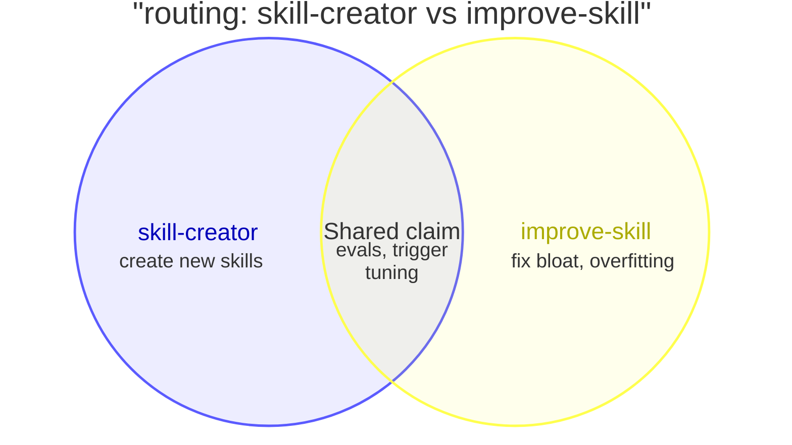

# Harness Overlap Audit

Find tools whose claimed scope overlaps, so the model can pick the wrong one or
pay twice for the same work. Judge scope and intent, not shared words.

## Rules

1. **Never flag a built-in.** Built-in items ship with the harness, and the
   provider owns their overlaps. A finding needs at least one user-owned item.
   A built-in may appear in a diagram for context, but the fix always targets
   the user-owned side.
2. **User-owned** means the item exists because the user installed, enabled,
   connected, or wrote it. That includes optional plugins from the provider's
   own catalog.
3. **A finding needs a collision prompt**: one realistic user request for which
   both descriptions say "use me". If you cannot write one, it is not a finding.
4. **A pipeline is not a collision.** When one item invokes the other, or they
   are stages of one workflow (a ship skill that runs commit, then create-pr),
   do not report it.
5. **Do not audit agents on their own.** Agents count only inside the
   skill-agent check below.

## Provenance

Classify every item from what you can trace on disk. Treat an item you cannot
trace as built-in, and count it in the report footer.

| Built-in: never flag | User-owned |
| --- | --- |
| Core tools; unprefixed skills with no `SKILL.md` on disk, such as `loop` or `run` | Skills in `~/.claude/skills/` or `.claude/skills/` |
| Skills and MCP servers the app adds without an install step, such as `anthropic-skills:*` or desktop servers like `ccd_*` and `computer-use` | Every plugin in `~/.claude/plugins/installed_plugins.json`, including official ones from `claude-plugins-official` |
| | MCP servers in `~/.claude.json`, `.mcp.json`, or a plugin's `.mcp.json`, and connectors the user connected |

## Workflow

1. **Inventory.** List each skill and MCP tool the model can pick, from your
   own context: the skill list and the tool list you route by. Keep only the
   name and description, because skill bodies do not affect which tool gets
   picked.
   Deferred MCP tools show only their names. Load full descriptions with
   `ToolSearch` only for the suspects you find in step 3.
2. **Provenance.** Classify each item with the table above.
3. **Group by job**, such as scheduling, code review, debugging, docs, memory,
   or diagrams. Compare items only inside a group. Skip a group with no
   user-owned item.
4. **Routing check.** For each pair in a group, write the collision prompt or
   drop the pair. Read a skill body only to confirm a pipeline.
5. **Port check.** A port is a user-owned skill that re-creates another
   harness's built-in. For example, `run-and-verify-app` brings Claude Code's
   built-in `run` and `verify` skills to Codex. A port belongs only where its
   built-in is missing, so judge it against this harness's built-ins only:
   - Beside the built-in it copies: 🔴 Duplicate. Fix: remove the port from
     this harness, and keep it where the built-in is missing.
   - Where no such built-in exists: correct. Do not report it.
6. **Skill-agent check.** For each user-owned skill that starts two or more
   agents, read those agents' prompts. Find them in the skill's
   `metadata.agents`, in agent files the body names, or in the skill's
   `agents/` folder (`openai.yaml` there is not an agent). Flag agents that
   check the same aspects: every run pays for that work twice.
7. **Rank** by level, then by how common the collision prompt is.

| Level | Meaning | Typical fix |
| --- | --- | --- |
| 🔴 Duplicate | Same scope and triggers, or a port beside its built-in | Remove one |
| 🟠 Competing | Shared trigger zone, different behavior | Narrow one description, or stop the model from starting it |
| 🟡 Nested | One scope sits inside the other | Exclude the inner scope from the outer description |

## Report

Write `harness-overlap-audit-<YYYY-MM-DD>.md` in the working directory, in the
user's language. The reader has little attention to spare, so the most
important finding goes first and nothing appears that does not lead to a fix.
In chat, reply with only the summary line and the report path.

Use this layout:

```markdown
# Harness overlap audit: <harness>, <date>

🔴 <n> duplicate · 🟠 <n> competing · 🟡 <n> nested

## 1. 🔴 routing: <item> vs <item>

<Venn diagram>

**Collision prompt:** "<prompt>"
**Fix:** <one action on the user-owned side>

## Other findings

| # | Level | Check | Items | Collision prompt | Fix |
| --- | --- | --- | --- | --- | --- |

Checked <n> skills, <n> MCP tools, <n> skills with agents. Untraceable, treated as built-in: <n>.
```

- The check in a heading is `routing`, `port`, or `inside <skill>`.
- Draw a Venn diagram for the top three findings only. Every other finding is
  one table row.
- Use at most three circles per diagram. Put the shared claim in the overlap
  and what is unique in each outer region, four words or fewer per label. Do
  not set sizes with `:N`, because the audit measures no sizes.
- With no findings, write only the summary line `No overlaps found` and the
  footer.

Draw each diagram with Skill(mermaid-diagrams:mermaid) using its
`venn-beta` reference, then validate it with
Skill(mermaid-diagrams:mermaid-lint). If linting cannot run, still write
the report, and put a one-line warning above the summary that the diagrams are
not validated.

Example of one diagram:


