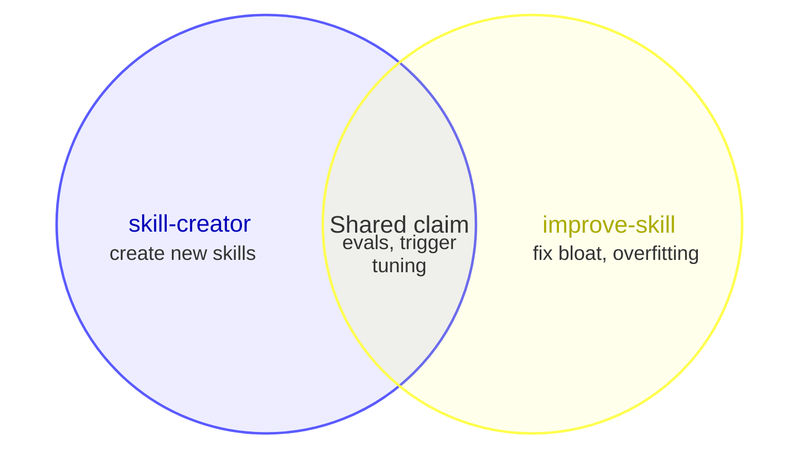

# Harness Overlap Audit

Find skills and MCP tools whose claimed scope overlaps. Judge intent, not shared
words.

## Provenance

**Never flag a built-in**: the provider owns its overlaps. Every finding needs a
user-owned item: one the user installed, enabled, connected, or wrote,
including optional plugins from the provider's catalog. Count an untraceable
item as built-in, in the footer.

- **Built-in:** core tools; unprefixed skills with no `SKILL.md` on disk, such
  as `loop` or `run`; items the app adds without an install step, such as
  `anthropic-skills:*` and desktop MCP servers like `ccd_*`.
- **User-owned:** `~/.claude/skills/`, `.claude/skills/`; plugins in
  `~/.claude/plugins/installed_plugins.json`, including
  `claude-plugins-official` ones; MCP servers in `~/.claude.json`, `.mcp.json`,
  or a plugin `.mcp.json`; connected connectors.

## Checks

1. **Inventory** the skills and MCP tools you route by, from your own context:
   names and descriptions only, since bodies do not affect routing.
   Deferred MCP tools show only names; load descriptions with `ToolSearch` for
   suspects only.
2. **Group by job**, such as scheduling, review, or docs. Skip groups with no
   user-owned item.
3. **Routing.** A pair is a finding only if you can write a **collision
   prompt**: one realistic request both descriptions claim. A pipeline is not
   a finding: one item invokes the other, or both are stages of one workflow.
4. **Port.** A port is a user-owned skill that re-creates another harness's
   built-in, such as `run-and-verify-app`, which brings Claude Code's `run` and
   `verify` to Codex. Beside the built-in it copies in this harness, it is 🔴:
   remove it here, keep it where the built-in is missing. Anywhere else, do not
   report it.
5. **Inside a skill.** For a user-owned skill that starts two or more agents
   (`metadata.agents`, agent files its body names, or its `agents/` folder
   except `openai.yaml`), read their prompts and flag agents that check the
   same aspects. Never audit agents on their own.

Levels: 🔴 duplicate (same scope, or a port beside its built-in: remove one) ·
🟠 competing (shared triggers, different behavior: narrow a description or stop
the model from starting it) · 🟡 nested (one scope inside the other: exclude it
from the outer description). Every fix targets the user-owned side; a built-in
appears only as diagram context. Rank by level, then by how common the
collision prompt is.

## Report

Write `harness-overlap-audit-<YYYY-MM-DD>.md` in the working directory, in the
user's language. Most important first; nothing without a fix. Reply in chat
with only the summary line and the path.

```markdown
# Harness overlap audit: <harness>, <date>

🔴 <n> duplicate · 🟠 <n> competing · 🟡 <n> nested

## 1. 🔴 <routing | port | inside <skill>>: <item> vs <item>

<Venn diagram>

**Collision prompt:** "<prompt>"
**Fix:** <one action on the user-owned side>

## Other findings

| # | Level | Check | Items | Collision prompt | Fix |
| --- | --- | --- | --- | --- | --- |

Checked <n> skills, <n> MCP tools, <n> skills with agents. Untraceable, treated as built-in: <n>.
```

- Diagrams for the top three findings only; the rest are table rows.
- At most three circles; shared claim in the overlap, unique scope outside,
  four words or fewer per label; no `:N` sizes.
- No findings: the summary line `No overlaps found` and the footer only.

Draw with Skill(mermaid-diagrams:mermaid) (`venn-beta`) and validate
with Skill(mermaid-diagrams:mermaid-lint). If linting cannot run, still
write the report, with a one-line "diagrams not validated" warning above the
summary.


